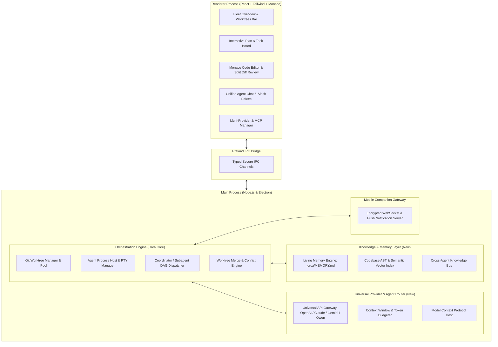

# Orca Next — System Architecture & Modular Design

Tài liệu này đặc tả kiến trúc kỹ thuật của **Orca Next**, đảm bảo tính mô-đun hóa, hiệu năng cao, mở rộng linh hoạt và không over-engineering.

---

## 1. Sơ Đồ Kiến Trúc Tổng Thể (High-Level Architecture)



---

## 2. Phân Tách Chi Tiết Theo 5 Khối Thành Phần

### 2.1. Những Gì Cần Giữ Nguyên (Keep Intact)

Orca hiện tại đã có những thành phần hoạt động xuất sắc và có độ tin cậy cao:

1. **Worktree Lifecycle Engine (`src/main/worktree-*`)**:
   - `worktree-create-preparation-pool.ts`: Tạo trước worktree ngầm để khởi động tức thì.
   - `worktree-removal-safety.ts`: Kiểm tra an toàn trước khi xóa nhánh, bảo vệ dữ liệu chưa commit.
   - `worktree-background-removal.ts`: Dọn dẹp không làm treo UI.
2. **Terminal Multiplexer (`node-pty` + `@xterm/headless` + OSC protocol)**:
   - Cơ chế bắt tín hiệu OSC `\x1b]9999;` để lấy trạng thái agent (working/blocked/waiting/done) mà không cần polling API.
3. **Enterprise Security Guard (`src/main/agent-workspace-trust.ts`)**:
   - Kiểm soát quyền truy cập file ngoài thư mục dự án và cấp quyền thực thi lệnh tự động an toàn.
4. **Mobile Companion Gateway (`mobile/` + `resources/`)**:
   - Đã có sẵn kiến trúc WebSocket và cặp mã QR (`tweetnacl`) kết nối điện thoại an toàn.

---

### 2.2. Những Gì Cần Tối Ưu (Optimize)

| Thành phần                     | Trạng thái hiện tại                                                                  | Giải pháp tối ưu trong Orca Next                                                                                                                                                                                        |
| :----------------------------- | :----------------------------------------------------------------------------------- | :---------------------------------------------------------------------------------------------------------------------------------------------------------------------------------------------------------------------- |
| **Quản lý RAM (Process Host)** | Mỗi agent terminal tiêu tốn ~80-150MB RAM; khi chạy 6-8 agents có thể vượt 1.5GB RAM | Triển khai **Agent Hibernation Policy**: Khi agent ở trạng thái `done` hoặc `waiting_for_input` > 10 phút, serialize terminal state vào disk và tạm ngưng PTY process; khôi phục trong <200ms khi người dùng tương tác. |
| **Monaco Editor Integration**  | Hiện tại chủ yếu dùng để xem diff tĩnh hoặc mở file đơn lẻ                           | Nâng cấp Monaco lên bản chia sẻ model cache (shared text buffer), tích hợp Language Server Protocol (LSP) nhẹ cho TypeScript/Python/Rust.                                                                               |
| **Slash Command Parsing**      | Đọc các file `.toml` rời rạc ở `~/.gemini/commands`                                  | Xây dựng **Unified Command Registry** trong `src/shared`: Tự động gộp Global Commands, Project Commands (`.orca/commands`), và Plugin Commands vào một in-memory indexed cache.                                         |
| **Worktree UI Rendering**      | Render danh sách worktree dài gây re-render toàn bộ sidebar                          | Áp dụng `@tanstack/react-virtual` vào danh sách Worktree và Pane cards để giữ 60fps mượt mà.                                                                                                                            |

---

### 2.3. Những Gì Cần Phát Triển Mới (Build New)

#### A. Living Project Memory Engine (`src/main/memory/`)

- **Cấu trúc lưu trữ**:
  ```text
  .orca/
  ├── MEMORY.md                 # Quy tắc cốt lõi, kiến trúc, coding standards
  ├── memory/
  │   ├── decisions.md          # Nhật ký quyết định kỹ thuật (ADRs)
  │   ├── feedback-rules.md     # Những điều người dùng nhắc nhở không được lặp lại
  │   └── design-freezes.md     # Danh sách API/Modules bị đóng băng không được sửa
  └── plans/
      └── <task-id>.md          # File kế hoạch có phase & checklist
  ```
- **Cơ chế hoạt động**:
  - Tự động nạp vào system prompt của mọi agent (bất kể Claude, Codex, Gemini hay Qwen).
  - Khi một agent phát hiện bài học mới (ví dụ: package A không tương thích với Next.js 15), Agent gọi tool `save_memory` để lưu lại cho các agent khác đọc.

#### B. Codebase Knowledge Graph & Indexer (`src/main/knowledge/`)

- Thay vì dùng vector database cồng kềnh, sử dụng kiến trúc hybrid siêu nhẹ:
  - **AST Symbol Extractor** (dùng `ast-grep` đã có sẵn trong repo): Trích xuất danh sách Classes, Functions, Interfaces, Exports và lưu thành JSON Graph.
  - **BM25 Keyword + Embedding Index**: Index tài liệu và tên file để agent tìm đúng code liên quan trong <50ms.

#### C. Interactive Plan Board UI (`src/renderer/src/components/plan/`)

- Mở rộng giao diện chat thành giao diện 2 cột:
  - _Cột trái_: Interactive Plan Checklist (hiển thị Phase 1, Phase 2, các checkbox task, tiến độ hoàn thành).
  - _Cột phải_: Terminal / Chat stream của Agent đang thực thi task đó.
- Người dùng có thể click tick chọn hoặc sửa lại task trên Plan trực tiếp.

#### D. Universal Multi-Provider Engine (`src/main/providers/`)

- Giao thức chuẩn hóa hỗ trợ 4 mode tích hợp:
  1. **Direct API (OpenAI-compatible / Anthropic / Google Gemini)**: Cho phép nhập API Key và Base URL tùy ý (hỗ trợ DeepSeek, Qwen, OpenRouter, Local Ollama).
  2. **Native CLI Launcher**: Tận dụng các CLI agent người dùng đã cài sẵn trên máy (Claude Code, Codex CLI, Gemini CLI, Qoder CLI, Pi).
  3. **Agent SDKs**: `@anthropic-ai/claude-agent-sdk`, `@cursor/sdk`.
  4. **Smart Fallback & Router**: Tự động chuyển đổi provider nếu gặp rate limit.

#### E. One-Click Worktree Merge & Rebase Engine (`src/main/worktree/merge/`)

- Khi Agent hoàn thành task trên branch `orca/feat-xyz`:
  - Hiển thị nút **"Review & Merge"**.
  - Tự động chạy git diff và linter.
  - Hỗ trợ 3 kiểu merge: Squash and Merge, Rebase and Merge, hoặc Tạo Pull Request (GitHub / GitLab / Linear).

---

### 2.4. Những Gì Nên Dùng Plugin / MCP (Plugin-Based)

Để giữ cho core của Orca luôn nhẹ, các tính năng sau được đóng gói dưới dạng Skills hoặc MCP Server:

- **Bộ quy tắc Senior Dev (Ponytail)**: Giữ dạng skill `/ponytail` để kích hoạt theo nhu cầu.
- **Quy trình kiểm thử TDD**: Dùng skill `test-driven-development`.
- **DevTools Browser Inspection**: Dùng MCP Server `chrome-devtools`.
- **Database Explorer**: Dùng MCP Server Postgres / SQLite / MySQL.

---

### 2.5. Thay Đổi Cốt Lõi Về UI/UX (UI/UX Transformation)

```text
┌─────────────────────────────────────────────────────────────────────────────┐
│ ✦ Orca Next  [Project: my-app]  [Branch: main]     [Memory: Active] [⚙ Settings] │
├──────────────┬──────────────────────────────┬───────────────────────────────┤
│ FLEET (3)    │ PLAN BOARD: Task #104        │ ACTIVE AGENT: Frontend Worker │
│ 🟢 Auth-Dev  │ [Phase 1: Setup]  ✓          │ [Claude 3.7 Sonnet] [Worktree]│
│    Claude    │ ├─ Create auth schema ✓      │ $ npm test auth.test.ts       │
│ 🟡 DB-Migrate│ └─ Setup JWT token    ✓      │ ✓ 5 tests passed              │
│    Codex     │ [Phase 2: UI Form] (Working) │                               │
│ ⚪ Test-Bot  │ ├─ Build Login Page   ⏳     │ Diff Preview:                 │
│    DeepSeek  │ └─ Add Google OAuth   ◻      │ + src/components/Login.tsx    │
│              │ [Phase 3: Verify]            │ + src/hooks/useAuth.ts        │
│ [+ New Agent]│ └─ E2E Playwright test◻      │ [Merge to Main] [Discard]     │
├──────────────┴──────────────────────────────┴───────────────────────────────┤
│ Slash Command: /interview-me  /ponytail  /spec  /test  /review  /memory     │
└─────────────────────────────────────────────────────────────────────────────┘
```

1. **Thanh Fleet Switcher (Bên trái)**: Hiển thị trạng thái các Agent đang làm việc trên từng worktree (kèm Attention Ring màu xanh/vàng/đỏ).
2. **Khu vực Plan & Context (Ở giữa)**: Bảng checklist tiến độ công việc, hiển thị trực quan các bước đã hoàn thành và bước kế tiếp.
3. **Khu vực Thực thi & Review (Bên phải)**: Terminal/Chat trực tiếp của agent được chọn kèm Diff Viewer và nút thao tác nhanh (Accept, Merge, Reject).
