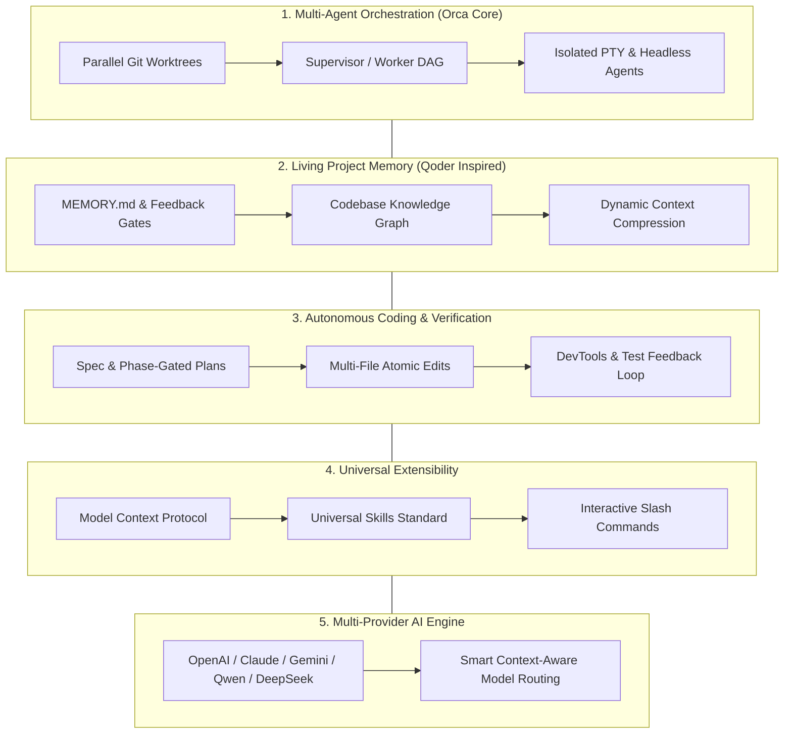

# Orca Next — Product Vision & Strategic Direction

> **"The Autonomous Multi-Agent Engineering Studio for 100x Builders"**  
> Kết hợp sức mạnh điều phối đa Agent song song của **Orca** với trải nghiệm lập trình sâu, trí nhớ dự án và tư duy quy trình kỹ thuật chuẩn mực của **Qoder**.

---

## 1. Bối cảnh & Tuyên ngôn Sản phẩm (Executive Summary)

Làn sóng AI Coding hiện nay đang trải qua bước chuyển từ **Code Assistant** (hỗ trợ viết code thụ động theo từng prompt) sang **Autonomous Agentic Engineering** (đặc tả yêu cầu, lập kế hoạch, code đa file, tự động test và tự hoàn thiện).

- **Qoder** đã chứng minh sức mạnh vượt trội ở khâu: Quản lý bộ nhớ dự án (`MEMORY.md`), lập kế hoạch nhiều giai đoạn (`Phase-Gated Planning`), hiểu sâu codebase (Repo Wiki & Knowledge Graph) và trải nghiệm tương tác mượt mà.
- **Orca** sở hữu vũ khí độc nhất trên thị trường: **Hệ thống điều phối Git Worktree song song**, cho phép 3-10 AI agent (Claude Code, Codex, Gemini/Antigravity, OpenCode, Pi, Qoder) làm việc cùng lúc trên các nhánh cách ly hoàn toàn, không xung đột file hay tài nguyên.

**Orca Next** được định vị là sản phẩm dung hợp hoàn hảo:
Một **AI Engineering Studio** hoàn chỉnh, nơi nhà phát triển đóng vai trò **Tech Lead / Architect**, điều phối một đội ngũ AI Agent chuyên biệt làm việc trên các worktree riêng biệt, được trang bị bộ nhớ dùng chung, hệ thống kỹ năng chuẩn mực và khả năng tự kiểm chứng chất lượng code trước khi bàn giao.

---

## 2. Các Trụ Cột Cốt Lõi (5 Strategic Pillars)

### Trụ cột 1: Điều phối Đa Agent Song song (Autonomous Multi-Agent Fleet)

- Mỗi Agent hoạt động trong một **Git Worktree độc lập**, đảm bảo không bao giờ có xung đột ghi đè file hoặc lock package manager.
- Cơ chế **Supervisor & Worker DAG**: Agent kiến trúc sư chia nhỏ task thành các sub-tasks độc lập và điều phối cho các worker agents (Frontend agent, Backend agent, Test agent) chạy song song.
- Đồng hành mọi lúc qua **Orca Mobile Companion** (iOS/Android): nhận thông báo khi agent cần duyệt diff hoặc hoàn tất task.

### Trụ cột 2: Trí nhớ Dự án & Context Engineering (Living Memory)

- **Project Memory 2 tầng**:
  - _Dài hạn (`MEMORY.md`)_: Quy chuẩn kiến trúc, conventions, design freezes, các bài học từ lỗi cũ.
  - _Ngắn hạn (`Session Scratchpad`)_: Tiến độ hiện tại, các quyết định vừa thống nhất, context của phiên làm việc.
- **Codebase Knowledge Base / Repo Wiki**: Tự động đánh chỉ mục AST, dependency graph và tóm tắt kiến trúc mô-đun để Agent nạp đúng 100% ngữ cảnh liên quan mà không tràn context window.

### Trụ cột 3: Lập Kế Hoạch & Kiểm Chứng Tự Động (Plan-First Autonomous Coding)

- Không cho phép Agent "nhảy vào gõ code bừa bãi". Mọi yêu cầu phức tạp đều phải qua pha **Spec & Planning**.
- **Phase-Gated Execution**: Kế hoạch chia thành các Phase với Checkpoint rõ ràng. Người dùng hoặc Supervisor Agent có thể review và duyệt từng Phase.
- **Mandatory Verification**: Mọi thay đổi phải vượt qua kiểm tra (Typecheck, linter, unit test hoặc visual diff qua Headless Browser/DevTools) trước khi được tính là hoàn thành.

### Trụ cột 4: Hệ thống Kỹ năng & Tiện ích Mở rộng (Universal Extensibility)

- Hỗ trợ đầy đủ **Model Context Protocol (MCP)** để kết nối với cơ sở dữ liệu, GitHub/Linear/GitLab, Terminal, Browser.
- Quản lý **Skills chuẩn mở** (`SKILL.md`): Tương thích chéo giữa Antigravity, Claude Code, Cursor, Codex và Qoder.
- Giao diện **Slash Commands phong phú** (`/ponytail`, `/spec`, `/test`, `/review`, `/interview-me`) hỗ trợ autocomplete ngay trên thanh chat.

### Trụ cột 5: Độc lập Nhà cung cấp (Multi-Provider & BYOK Flexibility)

- Tuyệt đối không trói buộc người dùng vào bất kỳ model hay vendor độc quyền nào.
- Hỗ trợ **BYOK (Bring Your Own Key)** cho tất cả các nhà cung cấp hàng đầu:
  - Anthropic Claude (Claude 3.7 Sonnet / Opus với Extended Thinking)
  - OpenAI Codex / GPT-4o / o1 / o3
  - Google Gemini (Gemini 2.5 Flash / Pro với context 1-2M tokens)
  - Alibaba Qwen & Qoder backend
  - DeepSeek (V3 & R1)
  - Local Models qua Ollama, vLLM hoặc LM Studio.
- **Smart Model Routing**: Tự động dùng model siêu nhanh, giá rẻ (Flash/Haiku) cho việc index, search, phân loại task; dùng model reasoning cao cấp (Claude 3.7 Thinking / o3-mini) cho khâu lập kiến trúc và giải quyết bug hóc búa.

---

## 3. Lợi Thế Cạnh Tranh Của Orca Next

| Đặc điểm               | Cursor / Windsurf    | Qoder                   | Orca Hiện tại                 | **Orca Next (Mục tiêu)**                          |
| :--------------------- | :------------------- | :---------------------- | :---------------------------- | :------------------------------------------------ |
| **Mô hình làm việc**   | 1 Agent tuần tự      | 1 Agent nâng cao        | Đa Agent song song (Worktree) | **Đa Agent song song + Trí nhớ hợp nhất**         |
| **Cách ly Workspace**  | Chung workspace      | Chung workspace         | Git Worktrees độc lập         | **Git Worktrees độc lập + Auto-merge engine**     |
| **Trí nhớ dự án**      | Yếu (Rules tĩnh)     | Rất mạnh (Memory/Plans) | Tối thiểu (chỉ lưu state)     | **Mạnh ngang Qoder + Chia sẻ giữa các Agent**     |
| **Code Review / Diff** | Tốt (Editor native)  | Tốt                     | Tốt (Diff viewer)             | **Interactive Multi-file Review + AI Self-Audit** |
| **Multi-Provider**     | Hạn chế cấu hình sâu | Rất tốt (Custom API)    | Tốt (Nhận diện nhiều CLI)     | **Universal BYOK + Smart Model Router**           |
| **Mobile Control**     | Không có             | Không có                | Có sẵn (iOS/Android app)      | **Nâng cấp Dashboard & Approval từ điện thoại**   |

---

## 4. Đối Tượng Người Dùng & Chân Dung

1. **Senior Engineers / Tech Leads**: Cần một công cụ để điều phối 3-5 luồng công việc cùng lúc (refactor backend, tạo API, viết unit test, dựng giao diện) mà không phải chuyển qua lại giữa nhiều cửa sổ.
2. **Full-stack Solo Founders / 100x Builders**: Cần năng suất tối đa, biến ý tưởng thành sản phẩm trong vài giờ bằng cách giao việc cho các agent chuyên môn hóa.
3. **Enterprise Dev Teams**: Cần bảo mật (BYOK, local model), audit trail rõ ràng, tuân thủ tiêu chuẩn code và có trí nhớ dự án bền vững theo thời gian.
